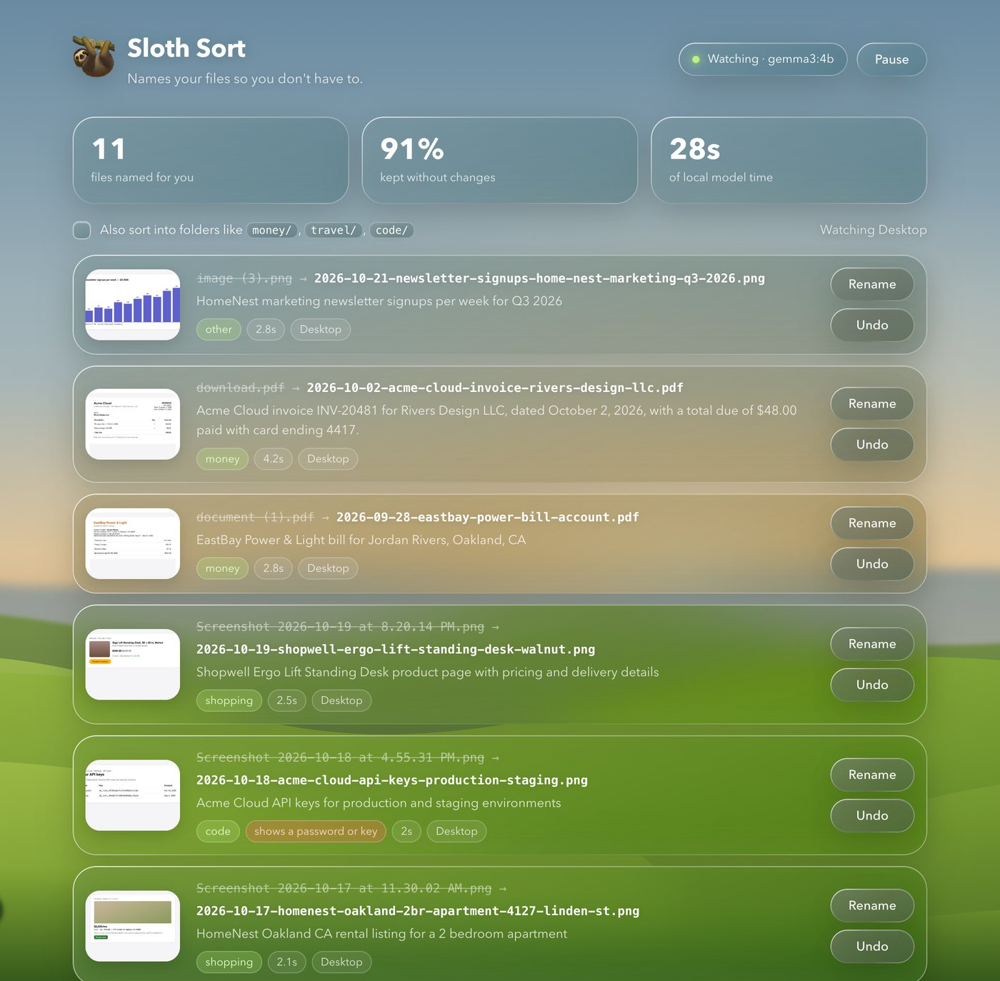

# 🦥 Sloth Sort

**Names your files so you don't have to.**

Your Desktop is full of `Screenshot 2026-10-14 at 9.41.22 AM.png`. Your Downloads folder has `download.pdf`, `document (1).pdf` and `image (3).png`. You'll rename them later. You won't.

Sloth Sort watches those folders. When a file with a throwaway name lands there, an open-weight model running on your own computer (Google's **Gemma 3**, through **Ollama**) looks at it, figures out what it is, and gives it a name a tidy person would have picked:

```
Screenshot 2026-10-14 at 9.41.22 AM.png  →  2026-10-24-skyline-air-boarding-pass-sfo-to-jfk.png
Screenshot 2026-10-15 at 2.03.10 PM.png  →  2026-10-15-python-billing-customer-id-error.png
download.pdf                             →  2026-10-02-acme-cloud-invoice-rivers-design-llc.pdf
Scan 2026-10-12.pdf                      →  2026-10-12-corner-hardware-oakland-paint-supplies-receipt.pdf
```

Nothing leaves your computer. Screenshots are full of bank balances, private chats and API keys, so the model runs locally, and the review page is only reachable from your own machine.



## What it does

- **Watches** `~/Desktop` and `~/Downloads` (or any folders you pick) and handles new images and PDFs one at a time.
- **Only touches throwaway names.** `Screenshot …`, `IMG_4821`, `download (2).pdf`, `Scan …`, hashes and UUIDs get renamed. `taxes 2025 notes.pdf` is left alone, because you named it.
- **Reads the file, not just the name.** Gemma 3 looks at screenshots and photos directly. For PDFs it gets the first page as an image plus the text layer, so phone scans without any text still work.
- **Dates come first**, so files sort by when they happened: the date printed on an invoice or ticket if there is one, otherwise when the file was made.
- **Undo is one click.** Every rename is written to a journal *before* the file moves, and the review page lets you undo or retype any name. Undone files are never touched again.
- **Optional folders.** Flip a switch and files also move into `money/`, `travel/`, `code/`, `chats/`, `shopping/`, `work/`, `photos/` or `memes/`.
- **Warns you about secrets.** If a screenshot shows a password, API key or full card number, the review page flags it so you can delete it.

## The rules live in code, not in the prompt

A model is good at reading a boarding pass. It is not something you trust with your file system. So the model only suggests words, and plain Python decides what a filename is allowed to be ([`slothsort/naming.py`](slothsort/naming.py)):

| Rule | Why |
| --- | --- |
| Long digit runs, emails and phone numbers are scrubbed from every name | Filenames show up in Spotlight, cloud sync logs and email attachments. `chase-statement-7730-2219-5541.pdf` should never exist. |
| A date from the model is used only if a full day, month and year is printed on the file | Small models fill gaps. "Thu, Oct 29" once became `2023-10-29`, and "Q3 2026" once became July 1. |
| Names are lowercase ASCII, at most 60 characters, and never repeat the date | They work in every terminal, URL and cloud drive. |
| A file is never overwritten; a clash gets `-2`, `-3` | Your data is worth more than a pretty name. |
| A file that is still downloading is not touched until its size stops changing | No half-written PDFs. |

## Run it

You need macOS or Linux, Python 3.11+, and [Ollama](https://ollama.com).

```bash
ollama pull gemma3:4b
python -m venv .venv && source .venv/bin/activate
pip install -r requirements.txt
python -m slothsort
```

Then open <http://127.0.0.1:8765>. New files are named as they arrive. Old files already sitting there show up as a "Tidy them" button.

### Or with Docker

Sloth Sort ships as two images, and Ollama keeps running on your computer so it can use the GPU:

| Image | What's in it |
| --- | --- |
| `sloth-sort-backend` | The API and folder watcher (Python). It mounts `~/Desktop` and `~/Downloads` and calls Ollama on the host. |
| `sloth-sort-frontend` | The review page on nginx. It proxies `/api` to the backend. |


```bash
ollama pull gemma3:4b
docker compose up -d
```

The review page is at <http://127.0.0.1:8765>. Only the frontend publishes a port, and only on `127.0.0.1`; the backend is reachable only from the frontend container. On a Mac, macOS may ask whether Docker can access your Desktop and Downloads folders; it needs that to rename files. Undo history lives in the `sloth-state` volume.

### Preview first

Want to see what it would do before it touches anything?

```bash
python -m slothsort scan ~/Downloads            # preview only
python -m slothsort scan ~/Downloads --apply    # rename for real (undo from the review page)
```

Try it on made-up clutter first:

```bash
python scripts/make_demo_files.py ~/Desktop/sloth-demo
python -m slothsort scan ~/Desktop/sloth-demo
```

### Settings

| Variable | Default | |
| --- | --- | --- |
| `SLOTH_WATCH` | `~/Desktop,~/Downloads` | Comma-separated folders to watch |
| `SLOTH_MODEL` | `gemma3:4b` | Any Ollama vision model. `gemma3:12b` names slightly better, but is about 2× slower and needs ~8 GB of memory |
| `SLOTH_SORT_FOLDERS` | `0` | `1` = also move files into category folders |
| `SLOTH_RENAME_ALL` | `0` | `1` = rename every image and PDF, not just throwaway names |
| `SLOTH_PORT` | `8765` | Review page port (always bound to 127.0.0.1) |
| `OLLAMA_URL` | `http://localhost:11434` | |

The model unloads itself after 5 idle minutes, so Sloth Sort costs nothing while you're not making clutter.

## How well does it name things?

[`scripts/eval.py`](scripts/eval.py) runs the model on 11 made-up files (screenshots, a text PDF, an image-only scan, a chart, a meme, a page full of API keys). It checks each name for the right words, category, date and secret flag. Results are in [`docs/eval/`](docs/eval/).

## Tests

```bash
pip install pytest && python -m pytest -q
```

The tests cover the naming rules and the full rename, undo and edit flow, with the model stubbed out, so they run without Ollama.

## License

MIT
